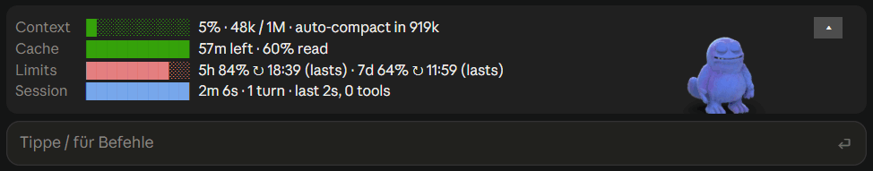

# Ranko


Ranko is a Claude Code mod that keeps the figures of your session in view,
in a band above the prompt: how full the context is and how far off
auto-compaction is, how long the prompt cache stays warm, how much of your
plan's 5-hour and weekly limits you have used and when they run full, and
how far Claude's task list has come. A Compact button sits beside the
context.

Beside the figures lives Ranko, the [rankello®](https://rankello.ai) mascot,
and shows at a glance what Claude is doing: he types while it works, thinks
along, holds up a prop for the tool it runs, and stands up and waves when it
waits for you.

The figures show in every terminal and in the Claude desktop app; Ranko
himself shows in the desktop app and in terminals that draw pictures (kitty,
Ghostty).



Meet him and rankello® at [rankello.ai](https://rankello.ai). Developed and
maintained by [milkycode®](https://www.milkycode.com).

## What the band shows

Each row has a bar and a reading:

| Row | What it tells you |
| :-- | :-- |
| **Context** | How full the context window is, in percent and tokens, and how many tokens are left before auto-compaction runs. From 15% on a Compact button sits beside it; it stands out in the last tenth before auto-compaction, or from 80% without it. |
| **Cache** | How long the prompt cache stays warm after the last request, and how much of that request it served. Once it lapses, the next request pays for the whole prompt again. |
| **Limits** | Your plan's 5-hour and weekly use, when each resets, and when each runs full at the pace you are using it. The bar shows the 5-hour window's use, green, yellow from half and red from 80%; the reading turns yellow when that window would run out before it resets. |
| **Tasks** | While Claude keeps a task list: how many tasks are done and the one under way. |
| **Session** | Without a task list: how long the session has run, its turns, the agents, background shells and wakeups under way, and the turn under way or the last one. Its bar shows how much of the 5-hour window has passed, to set beside how much of it is used. |

- **Compaction summaries.** After a compaction, by the button or `/compact`,
  the conversation shows the summary Claude carries on with, under a line
  with the tokens before and after. The lines are for you; Claude doesn't
  read them.
- **One line, if you like.** The ▴ button at the band's top right folds it
  to one line of figures and the Compact button, without Ranko; the band
  stays folded in later sessions until you open it again.
- **Fresh, and frugal.** The figures are read again every 10 seconds and
  after every response. The limits come from where `/usage` reads them, so
  your other sessions count too: your sessions share one reading a minute,
  and when the endpoint asks them to wait, they all do.

## What Ranko does

- **Moods.** He waves hello when a session starts; breathes, blinks and
  swings his tail while he waits; sits down and types on his laptop while
  Claude works; jumps for joy after a long turn; clutches his head with a
  sweat drop when a tool fails or you interrupt; and dozes off on a cushion,
  z's rising, when left alone for two minutes.
- **What Claude is doing.** While a tool runs he holds a prop for it: a
  magnifier to read or search, a notepad to edit or keep the task list,
  binoculars for the web and the browser. While Claude thinks, he puts a
  finger to his chin and looks up. Each subagent gets a mini Ranko beside
  him, which walks off when it is done.
- **When you are wanted.** When Claude waits for your permission or for your
  answer to a question, he stops typing, stands up and waves, then says psst
  every half minute until you answer.
- **Work done.** A commit, a push, a pull request opened or merged, or a
  test run that passes gets a thumbs up.
- **The context.** He grows rounder as the context fills, a resumed
  session's too, and lets it out with a sigh on compaction.
- **You and him.** Pat him and hearts float up; drag him along the band and
  he dangles; thank him, in English or German, and he blushes behind his
  hands. Left alone a while, he scratches his head, says psst, gives a thumbs
  up or looks around.

He sits down and gets up between all of these rather than jumping.

## Where it runs

| Where | Figures | Ranko |
| :-- | :-- | :-- |
| kitty, Ghostty | yes | yes, drawn through the kitty graphics protocol |
| Other terminals, Windows Terminal among them | yes | no |
| Claude desktop app | yes | yes, each frame a WebP in an SVG, up to ten a second |

On Windows the desktop app is the easy way to meet him; in a terminal, run
Claude Code in WSL inside kitty (WSLg). In the desktop app, while you drag
him, a dashed frame shows where he will land, and he moves when you let go.

He goes easy on your machine: asleep for a minute, he is drawn four times a
second; after ten he holds still, drawn not at all, until you type in the
prompt or a turn starts.

## Install

```
/plugin marketplace add milkycode/ranko
/plugin install ranko@ranko
```

Needs Claude Code 2.1.287 or later with mods on. Mods are rolling out; if
`/ranko` isn't listed after installing, they aren't on for your account yet.

The desktop app loads a mod installed from a terminal at the user scope:
install it there, then start a new session in the app.

To run it from a checkout instead:

```bash
claude --plugin-dir path/to/ranko
```

## Commands and switches

- `/ranko` hides or shows the band, figures and Ranko both.
- `/ranko collapse` folds the band to one line of figures and the Compact
  button, as the ▴ button at its top right does; `/ranko expand` or the ▾ at
  the line's right end opens it again.
- `/ranko <reaction>` plays one of his reactions, e.g. `/ranko hello`:
  `blush`, `deflate`, `doze-off`, `drop`, `fidget-look`, `fidget-psst`,
  `fidget-thumbs`, `fidget-wonder`, `happy`, `held`, `hello`, `idle`,
  `idle-plump`, `idle-stuffed`, `oops`, `pat`, `sit-down`, `sleepy`,
  `stand-up`, `wake-up`, `working`, `working-binoculars`, `working-magnifier`,
  `working-notepad`, `working-plump`, `working-stuffed`, `working-thinking`.
- `/ranko list` shows every reaction, and every switch with its state. While
  you type, `/ranko` offers its reactions, its verbs and, after `on` or
  `off`, the switches.
- `/ranko on <switch>` / `/ranko off <switch>` flips a switch, as
  `/plugin configure ranko@ranko` does. All are on to begin with:
  - the figures: `stats` (the rows beside Ranko and the folded line),
    `compactSummary`;
  - Ranko: `drag`, `pats`, `toolProps`, `thinking`, `miniRankos`,
    `stuffing`, `blush`, `attention`, `thumbsUp`, `fidgets`, `sounds`.

Sounds play on macOS only. The cache's countdown assumes an hour when you are
logged in with a Claude plan and five minutes with an API key: Claude Code
doesn't say which one it asked for.

## How he is made

Ranko is frames baked in Blender, played above the prompt: in a terminal by
swapping an `Image`'s source with `$.ui.blit`, in the desktop app as an SVG
drawn anew for each frame. Everything is built by script in Blender 5.2,
headless; nothing is modelled by hand.

| Script | What it does |
| :-- | :-- |
| `blender/model.py` | sculpts him as a signed distance field on a skeleton and meshes it with OpenVDB |
| `blender/look.py` | fur, materials, eyes, lights |
| `blender/rig.py` | armature, skin weights from the shapes each bone carries, lids, poses |
| `blender/clips.py` | the motion of every clip, frame by frame |
| `blender/bake.py` | renders each frame as a plush and a shadow layer |
| `blender/composite.py` | lays them over each other into `assets/frames`, as a PNG for the terminal and a WebP for the desktop app |
| `blender/preview.py`, `review.py`, `fit.py` | large renders beside the reference pictures |
| `blender/gif.py` | plays clips as a GIF, to watch a motion outside a terminal |

Rebake the frames:

```bash
blender -b --factory-startup -P blender/bake.py -- render build/layers [clip ...]
python3 blender/composite.py build/layers assets/frames [clip ...]
```

`python3 blender/composite.py --webp assets/frames` writes the WebPs anew
from the PNGs alone, without the layers.

A frame takes about 12 seconds on an RTX 4060 (CUDA), most of it for the fur;
all of them take three hours.

## Test

```bash
claude plugin test .
```

It runs every `*.test.tsx` under the folder.

## License

MIT for the code, the Blender and sound scripts, and the frames and sounds
they make; see [LICENSE](LICENSE). The Ranko character and the Rankello name
are registered trademarks of milkycode GmbH, and the license doesn't cover them.
